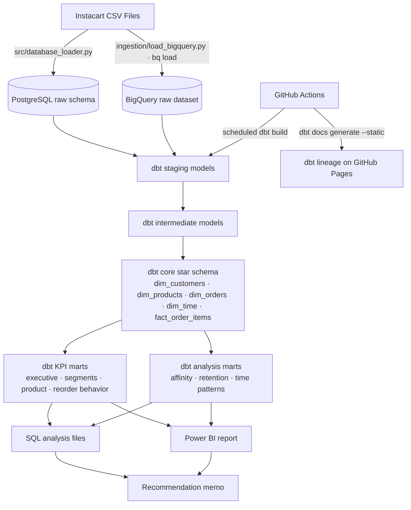
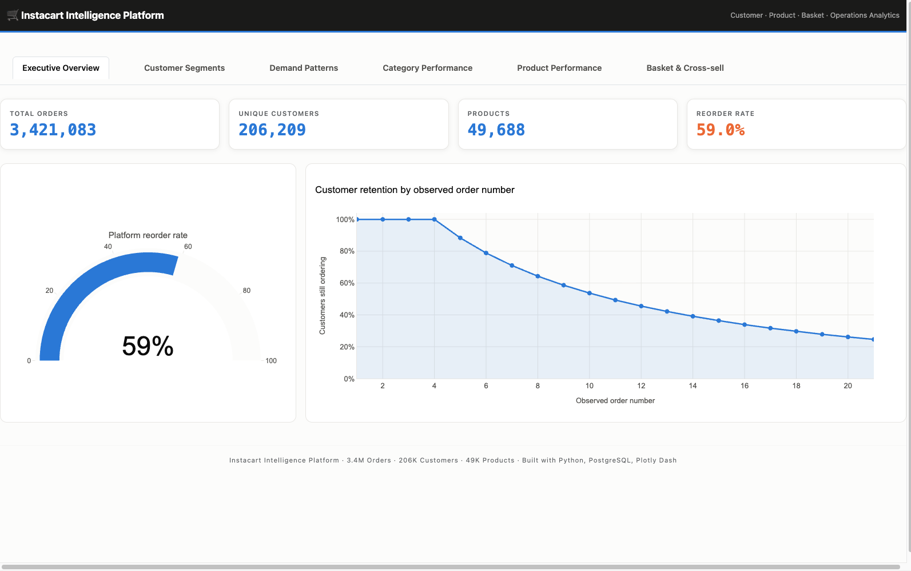
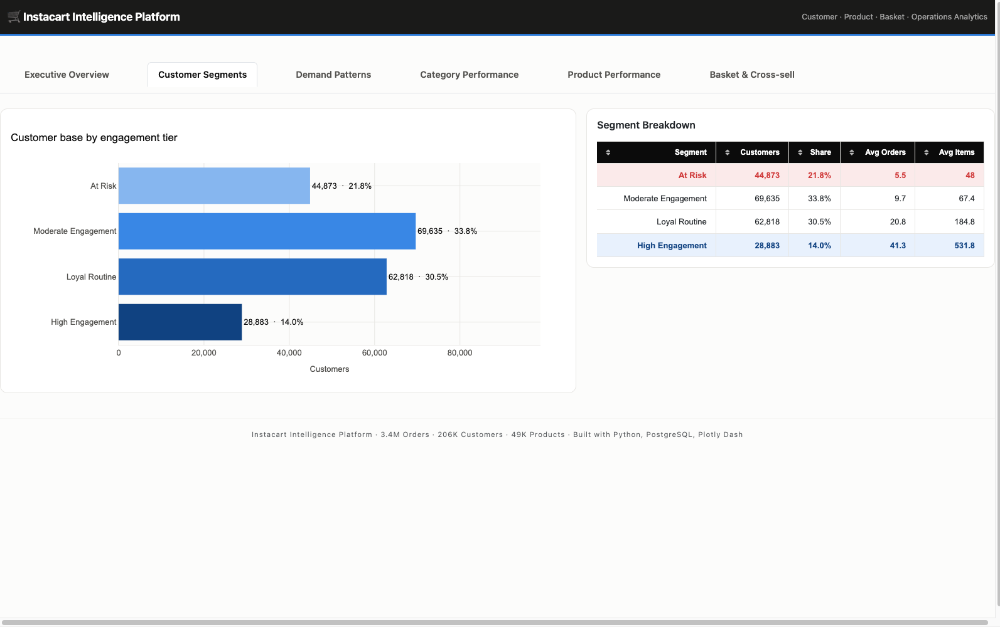
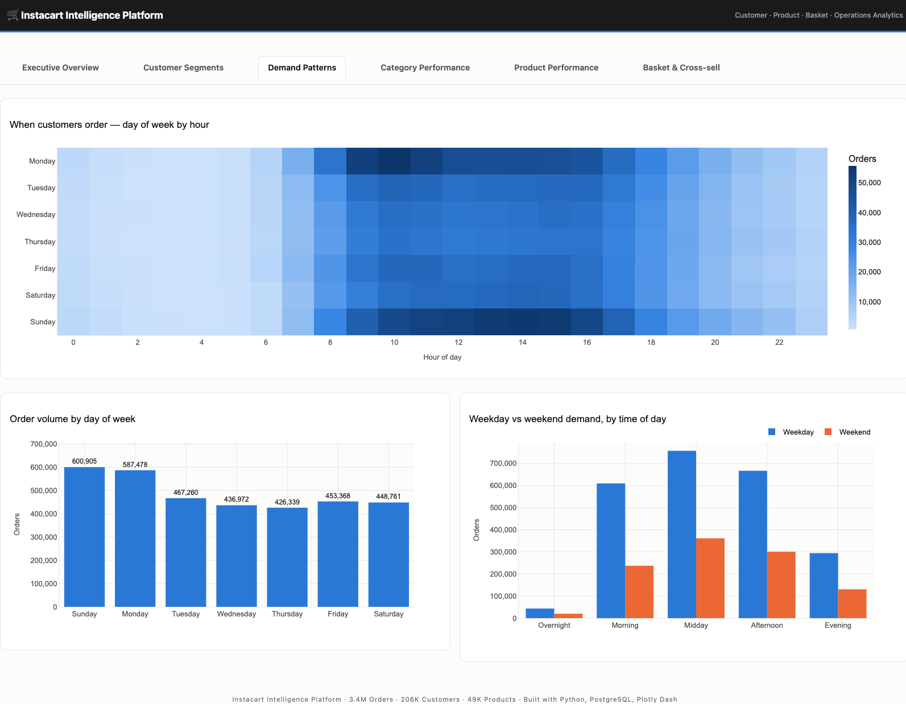
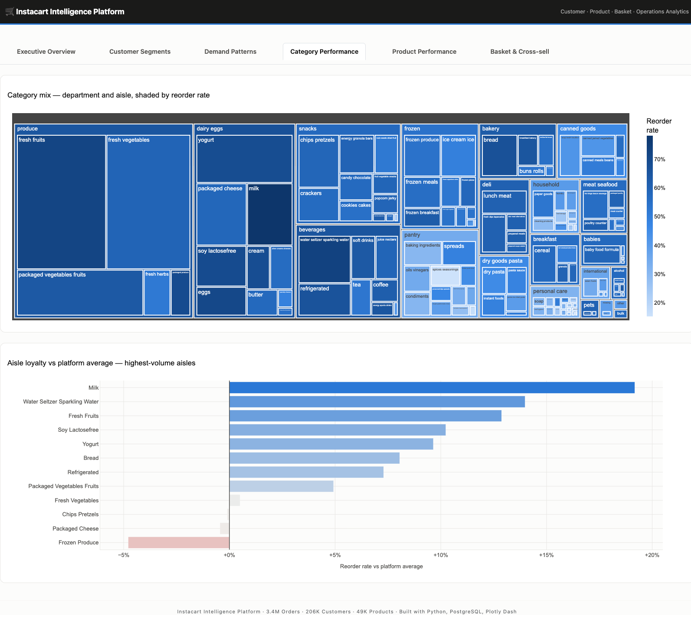
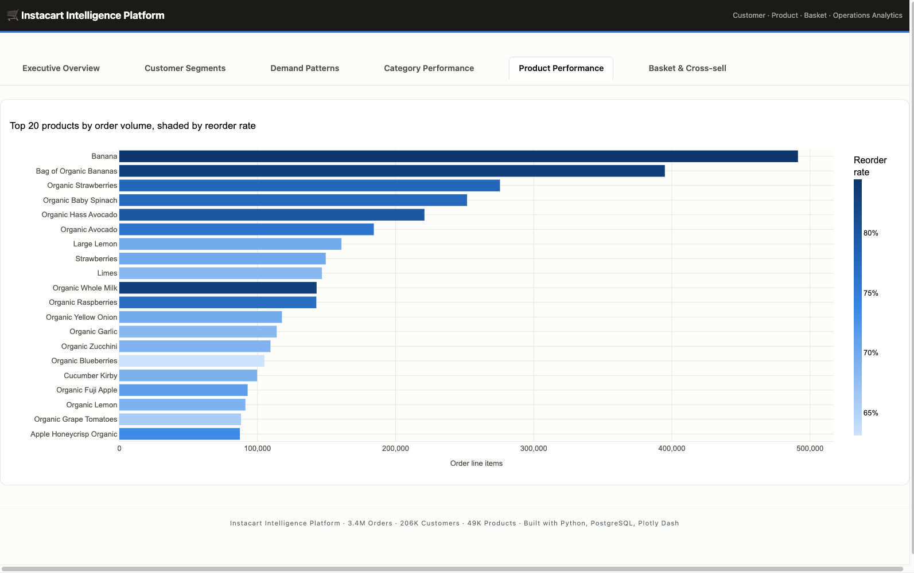
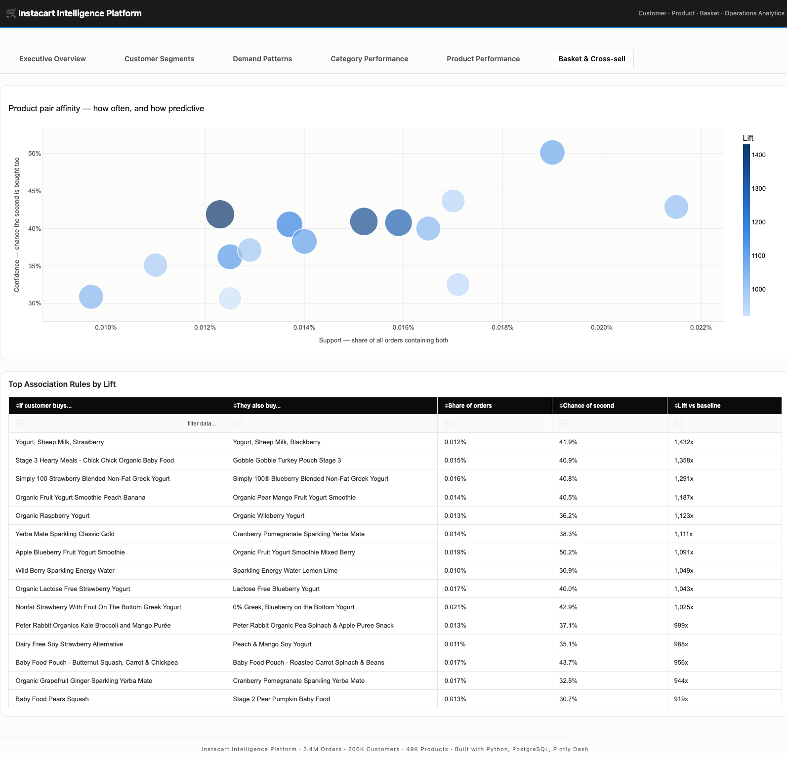

# Instacart Customer & Operations Intelligence Platform

       

Analytics Engineering · PostgreSQL Warehouse · dbt Core · SQL Analysis · Power BI Planning

An end-to-end analytics engineering and BI project built on the public Instacart order dataset to analyze customer behavior, product performance, cohort retention, and basket affinity. This project engineers a local Dockerized PostgreSQL warehouse, models reusable analytics layers with dbt Core, adds recruiter-readable SQL analysis, and defines a Power BI dashboard plan connected to validated dbt marts.

---

## Project Value

This project turns retail transaction data into a clean analytics warehouse with reusable SQL assets, reliable loading, tested dbt models, business KPI marts, and executive-ready BI documentation.

It is especially strong for:
- Data Analyst
- Business Analyst
- Analytics Engineer
- Business Intelligence Analyst
- Product Analyst
- Junior Data Engineer

---

## Business Case & Objectives

In high-frequency e-commerce and grocery retail, improvements in repeat purchase behavior, basket composition, and customer lifecycle timing can directly inform retention and merchandising strategy. This platform addresses critical executive questions:

- Which customer cohorts continue through later observed order milestones?
- Which departments and individual products act as high-velocity drivers for repeat purchases?
- Which product pairs appear together often enough to support merchandising, placement, or cross-sell analysis?

---

## Data Warehouse Profile

The analytical engines ingest the anonymized **Instacart Market Basket Analysis** dataset, representing a dense relational network of consumer shopping behavior.

| Core Entity | Structural Metric |
| :--- | ---: |
| Total Orders Processed | 3,421,083 |
| Unique Customers | 206,209 |
| Product SKU Catalog Size | 49,688 |
| Active Departments | 21 |
| Platform Reorder Rate | 59.01% |

### Ingested Relational Schema
- `orders.csv` — User order cadences, weekdays, and hours of purchase.
- `order_products__prior.csv` / `order_products__train.csv` — Basket-level line item layouts and reorder flags.
- `order_products.csv` — Combined order-product line item file used by the PostgreSQL loader.
- `products.csv`, `aisles.csv`, `departments.csv` — Product catalog and category metadata.

---

## System Architecture



The same dbt project builds from either warehouse — see **Warehouse Targets** below.

Detailed architecture notes are available in:
- `docs/architecture.md`
- `docs/architecture_diagram.mmd`

---

## Specialized Solution Modules

### Module 1 — Behavioral Customer Engagement Segmentation
The dbt mart `mart_customer_segments` uses transparent SQL scoring to segment customers by observed order frequency, average basket size, reorder behavior, and a latest reorder-gap proxy.

Segmentation inputs:
- **Recency proxy:** `latest_days_since_prior_order` from each customer's latest observed order. This is not calendar recency.
- **Frequency:** observed order count per customer.
- **Basket behavior:** average basket size and total purchased line items.
- **Reorder behavior:** customer-level share of items marked as reordered.

| Behavioral Segment | User Count | Core Operational Action Item |
| :--- | ---: | :--- |
| High Engagement | 28,883 | Maintain loyalty and reinforce repeat behavior. |
| Loyal Routine | 62,818 | Support recurring habits and category expansion. |
| Moderate Engagement | 69,635 | Identify opportunities to deepen engagement. |
| At Risk | 44,873 | Review lifecycle messaging and reorder timing. |

**Data-driven insight:** Moderate Engagement is the largest segment with 69,635 customers, followed by Loyal Routine with 62,818 customers.

**Why there is no onboarding segment:** every customer in this extract has between 4 and 100 observed orders, so customers new to the platform are absent from the sample by construction. Segmenting for them would manufacture a lifecycle stage the data does not contain — see [Decision 8](docs/decisions.md).

### Module 2 — Cohort Retention & Reorder Velocity
The dbt mart `mart_cohort_retention` quantifies customer continuation across observed order-sequence milestones.

- Retention is based on order sequence, not calendar dates.
- `observed_order_number` is the BI-facing milestone.
- `retention_rate` is calculated as active customers at the milestone divided by starting customers.

Validated retention insights:
- 100.00% of customers are observed through order 3, 88.37% through order 5, 53.70% through order 10, 36.41% through order 15, and 26.15% through order 20.

### Module 3 — Basket Affinity Analysis
The dbt mart `mart_basket_affinity` performs SQL-first product affinity analysis for frequently co-occurring product pairs.

Metrics:
- `orders_with_a`
- `orders_with_b`
- `orders_with_both`
- `support`
- `confidence_a_to_b`
- `lift`

Validated product-pair insights:
- Strongest lift pair: Yogurt, Sheep Milk, Strawberry + Yogurt, Sheep Milk, Blackberry with 421 co-orders, 0.0123% support, 41.89% confidence, and 1,431.68 lift.
- Highest support pair: Bag of Organic Bananas + Organic Hass Avocado with 64,761 co-orders, 1.8930% support, 16.40% confidence, and 2.54 lift.

### Module 4 — Category & SKU Volume Analysis
The dbt mart `mart_product_performance` isolates product, aisle, and department performance.

Metrics:
- `total_order_items`
- `distinct_orders`
- `distinct_customers`
- `reorder_rate`

Validated category and SKU insights:
- Top SKU by item volume is Banana with 491,291 order items and an 84.51% reorder rate.
- Top department is produce with 9,888,378 order items; top aisle is fresh fruits with 3,792,661 order items.

### Module 5 — Temporal Demand Patterns
The dbt marts `dim_time` and `mart_time_patterns` expose demand across the finest time grain the dataset supports: day-of-week × hour-of-day.

The dataset carries no absolute timestamps, so `dim_time` is **generated** as the full 7 × 24 = 168-slot grid rather than derived from the orders table. A slot with no orders therefore renders as an empty heatmap cell instead of silently disappearing. A singular test asserts the grid is exactly 168 rows, and a second asserts that `sum(total_orders)` reconciles to the `dim_orders` row count — the guard against the grain bug where joining orders to line items multiplies order counts by basket size.

Validated temporal insights:
- Busiest slot: **Monday 10:00 with 55,671 orders** (1.627% of all orders).
- Quietest slot: **Wednesday 03:00 with 654 orders** (0.019%).
- Demand by daypart, with reorder rate:

  | Daypart | Orders | Reorder Rate |
  | :--- | ---: | ---: |
  | Midday (11-14) | 1,118,610 | 58.24% |
  | Afternoon (15-18) | 967,899 | 57.78% |
  | Morning (6-10) | 846,828 | **61.92%** |
  | Evening (19-23) | 424,481 | 58.23% |
  | Overnight (0-5) | 63,265 | 56.95% |

- **Morning is not the highest-volume daypart, but it carries the highest reorder rate at 61.92%** — 3.68 points above the platform rate of 59.01%. Morning traffic skews toward habitual restocking rather than discovery.

### Module 6 — Category Reorder Diagnostics
The dbt mart `mart_reorder_behavior` reports reorder rate per department × aisle, benchmarked against both the parent department and the platform. This is the category rollup: product-level reorder rate lives in `mart_product_performance` and customer-level in `dim_customers`.

Each row carries `reorder_rate_vs_department`, so the mart answers "which aisles under-perform their own department" rather than only ranking absolute rates. Aisles below a 1,000-line-item floor are **flagged** (`below_volume_floor`), not filtered, so department totals still reconcile to the platform total.

Validated category insights (134 aisles; platform reorder rate 59.01%):

| Aisle | Department | Order Items | Reorder Rate | vs Department |
| :--- | :--- | ---: | ---: | ---: |
| milk | dairy eggs | 923,659 | 78.18% | +11.16 pts |
| water seltzer sparkling water | beverages | 878,150 | 72.99% | +7.62 pts |
| fresh fruits | produce | 3,792,661 | 71.88% | +6.83 pts |
| spices seasonings | pantry | 221,371 | 15.29% | −19.45 pts |
| kitchen supplies | household | 9,620 | 19.48% | −20.85 pts |

- **Spices and seasonings is the largest low-repeat category**: 221,371 order items at a 15.29% reorder rate, 19.45 points below its own department. Consumption cycles are long, so volume does not convert into repeat purchase.
- All 134 aisles clear the 1,000-item volume floor, so **0 rows are flagged** on this dataset. The guard is retained because the floor is a property of the method, not of this extract.

---

## Interactive Dashboard Platform

The final BI output is planned for Power BI Desktop and should connect to dbt marts, not raw tables.

Power BI planning assets:
- `bi/powerbi_dashboard_plan.md`
- `bi/data_dictionary.md`

`bi/powerbi_dashboard_plan.md` is a complete build specification, not an outline: it contains 33 named DAX measure definitions, the exact mart column behind every visual, the model relationships and sort-by columns to set, and the conditional-formatting rules with thresholds and hex colours.

### Page 1 — Executive Overview
**Question: what is the current state of the platform?** Headline cards from `mart_executive_kpis`, the retention curve, department share, and a day × daypart matrix.

### Page 2 — Customer Segmentation
**Question: which customers are disengaging, and who is worth protecting?** Segment distribution plus a decision-oriented at-risk table listing the specific accounts, sorted by days since their last order. Labelled "Behavioural Segmentation" rather than "RFM" — see the limitations below.

### Page 3 — Basket & Cross-sell
**Question: which products sell together strongly enough to act on?** Support/confidence scatter and a pair table sorted by lift, with the eligibility thresholds stated on the page.

### Page 4 — Temporal Behavior
**Question: when do customers order, and does intent change by time of day?** The 168-cell day-of-week × hour heatmap fed by `mart_time_patterns`, coloured by each slot's share of the selected peak.

### Page 5 — Product & Department Performance
**Question: which categories under-perform their own department on repeat purchase?** The aisle diagnostic table sorted *ascending* by `reorder_rate_vs_department`, so the worst gaps surface first — a work queue rather than a leaderboard.

### Page 6 (optional) — Metric Explorer
A field-parameters page pairing a metric selector with a dimension selector.

---

## Tech Stack

- Python · pandas
- PostgreSQL 15 · Docker Compose · Dockerfile for a pinned dbt/Python runner
- **Google BigQuery** — second warehouse target, loaded by `ingestion/load_bigquery.py` via `bq load`
- dbt Core · dbt-postgres · dbt-bigquery · dbt_utils
- **GitHub Actions** — scheduled `dbt build`, PR validation, and dbt docs published to GitHub Pages
- SQL with CTEs, window functions, tests, and analytical marts
- Power BI Desktop design specification with DAX
- Mermaid architecture documentation
- Plotly Dash assets retained from the original project

---

## Warehouse Targets

The dbt project runs unchanged against **either PostgreSQL or BigQuery**. This is deliberate engineering, not a coincidence: the models use dbt cross-database macros — `{{ dbt.type_int() }}`, `{{ dbt.type_numeric() }}`, `{{ dbt.type_string() }}`, `{{ dbt.type_float() }}` — instead of Postgres-only `::numeric(10,4)` casts, `FILTER (WHERE ...)` clauses, and `VARCHAR`. `sources.yml` resolves its schema from `DBT_RAW_SCHEMA`, which is a Postgres schema on one target and a BigQuery dataset on the other.

| Target | Command | Loader | Status |
| :--- | :--- | :--- | :--- |
| PostgreSQL 15 (default) | `dbt build` | `src/database_loader.py` | **Verified** — full build `PASS=256 WARN=0 ERROR=0` |
| BigQuery | `dbt build --target bigquery` | `ingestion/load_bigquery.py` | Written and syntax-checked; **not yet executed** — requires GCP credentials |

Preview the BigQuery load without credentials:

```bash
python ingestion/load_bigquery.py --dry-run
```

Rationale for keeping both is in `docs/decisions.md` §1.

---

## Orchestration

Two GitHub Actions workflows make this a pipeline rather than a set of scripts.

| Workflow | Trigger | What it does |
| :--- | :--- | :--- |
| `.github/workflows/dbt_build.yml` | Weekly cron, manual dispatch, and pull requests | Full `dbt build` against BigQuery on schedule. On a PR it runs `dbt build --empty` into a PR-scoped dataset, which validates every model's SQL against BigQuery without rebuilding 33.8M rows. |
| `.github/workflows/dbt_docs.yml` | Push to `main`, manual dispatch | `dbt docs generate --static` and publishes the lineage graph to GitHub Pages. |

Weekly rather than daily is intentional: the source is a static Kaggle export, so a daily rebuild would re-derive identical results at real warehouse cost.

Required repository secrets: `GCP_SA_KEY`, `GCP_PROJECT`, `BQ_DATASET`, `BQ_RAW_DATASET`.

---

## Verified Build

Everything below is the output of an actual run, not an estimate.

| Check | Result |
| :--- | :--- |
| Full `dbt build` on PostgreSQL 15 | `PASS=256 WARN=0 ERROR=0 SKIP=0` |
| Models | 19 (12 tables, 7 views) |
| **dbt data tests** | **237** |
| Wall-clock build time | 6m 52s warm; **3h 35m 53s** on the first cold build |
| Compiled-node syntax check | 197 / 197 nodes plan cleanly under `EXPLAIN` |
| Cross-database rewrite regression check | 0 differences — every KPI, segment count, retention point, and row count identical before vs after |

For context, the reference bar for this portfolio was 41 tests; the dbt requirement in the brief was 40+.

**On the two build times.** The first full build of this project took 3h 35m 53s; an identical rebuild after the cross-database rewrite took 6m 52s and produced byte-identical marts. The most likely cause is planner statistics — the first build ran against freshly loaded tables with no `ANALYZE` statistics, so the `mart_basket_affinity` self-join over 33.8M rows would have been planned very differently. That is a hypothesis, not a measured conclusion; both timings are reported rather than only the flattering one.

Because a cold build can take hours, model changes are validated with `dbt parse` plus `EXPLAIN` on the compiled SQL, and full builds are backgrounded.

---

## Repository Structure

```text
instacart-intelligence-platform/
├── .github/
│   └── workflows/
│       ├── dbt_build.yml            # scheduled + PR dbt build against BigQuery
│       └── dbt_docs.yml             # dbt docs generate --static -> GitHub Pages
├── analysis/
│   ├── basket_affinity.sql
│   ├── cohort_retention.sql
│   ├── customer_segments.sql
│   ├── executive_kpis.sql
│   ├── product_performance.sql
│   └── recommendation_memo.md
├── bi/
│   ├── data_dictionary.md
│   └── powerbi_dashboard_plan.md    # full design spec: DAX, layout, formatting rules
├── dashboard/
│   └── app.py
├── data/
│   ├── processed/
│   └── raw/
├── dbt/
│   ├── README.md
│   ├── dbt_project.yml
│   ├── packages.yml                 # dbt_utils
│   ├── profiles.yml.example         # postgres + bigquery targets
│   ├── models/
│   │   ├── sources.yml
│   │   ├── staging/                 # stg_orders, stg_order_products, stg_products, stg_aisles, stg_departments
│   │   ├── intermediate/            # int_order_item_enriched, int_customer_order_history
│   │   └── marts/
│   │       ├── core/                # dim_customers, dim_products, dim_orders, dim_time, fact_order_items
│   │       ├── kpis/                # mart_executive_kpis, mart_customer_segments,
│   │       │                        #   mart_product_performance, mart_reorder_behavior
│   │       └── analysis/            # mart_basket_affinity, mart_cohort_retention, mart_time_patterns
│   └── tests/                       # singular tests: grain, grid completeness, order reconciliation
├── docs/
│   ├── architecture.md
│   ├── architecture_diagram.mmd
│   ├── decisions.md                 # decisions and tradeoffs, with the numbers behind them
│   ├── erd.md                       # star-schema entity relationship diagram
│   └── resume_bullets.md
├── ingestion/
│   └── load_bigquery.py             # CSV -> (GCS) -> BigQuery, with --dry-run
├── reports/                         # Dashboard captures and exported figures
├── sql/
│   ├── schema.sql
│   ├── rfm_analysis.sql
│   ├── retention_matrix.sql
│   └── category_deepdive.sql
├── src/
│   ├── database_loader.py           # CSV -> PostgreSQL raw schema
│   ├── market_basket.py
│   └── clv_rfm_engine.py
├── .env.example
├── CLAUDE.md
├── TASKS.md
├── Dockerfile
├── docker-compose.yml
├── requirements.txt
└── README.md
```

---

## How to Run

```bash
git clone <repository-url>
cd instacart-intelligence-platform

# Install Python dependencies
python3 -m venv venv
source venv/bin/activate
pip install -r requirements.txt

# Configure local PostgreSQL settings
cp .env.example .env

# Start PostgreSQL
docker compose up -d

# Load CSVs into the PostgreSQL raw schema
python src/database_loader.py

# Configure dbt
cp dbt/profiles.yml.example dbt/profiles.yml
export DBT_PROFILES_DIR=./dbt

# Validate and build dbt models
dbt debug --project-dir dbt
dbt run --project-dir dbt --select +path:models/marts
dbt test --project-dir dbt

# Run recruiter-readable analysis SQL
psql -h localhost -p 5434 -U postgres -d instacart_db -f analysis/executive_kpis.sql
psql -h localhost -p 5434 -U postgres -d instacart_db -f analysis/product_performance.sql
psql -h localhost -p 5434 -U postgres -d instacart_db -f analysis/customer_segments.sql
psql -h localhost -p 5434 -U postgres -d instacart_db -f analysis/cohort_retention.sql
psql -h localhost -p 5434 -U postgres -d instacart_db -f analysis/basket_affinity.sql
```

Cleanup:

```bash
docker compose down

# Full local PostgreSQL volume reset
docker compose down -v
```

---

## Key Metrics

- Total orders analyzed: 3,421,083.
- Total customers analyzed: 206,209.
- Total products analyzed: 49,688.
- Total order items analyzed: 33,819,106.
- Platform reorder rate: 59.01%.
- Average basket size: 9.89 items.
- Average orders per customer: 16.59.
- Active departments: 21.
- Top department by items: produce.
- Largest behavioral customer segment: Moderate Engagement with 69,635 customers.
- Retention at selected observed order milestones: order 1 100.00%, order 2 100.00%, order 3 100.00%, order 5 88.37%, order 10 53.70%, order 15 36.41%, order 20 26.15%.
- Top product affinity pairs by lift/support: strongest lift is Yogurt, Sheep Milk, Strawberry + Yogurt, Sheep Milk, Blackberry at 1,431.68 lift; highest support is Bag of Organic Bananas + Organic Hass Avocado at 1.8930% support.
- Product pairs meeting the affinity thresholds: 254,490, drawn from the 5,237 products (10.5% of the catalog) appearing in at least 1,000 distinct orders.
- Busiest hour slot: Monday 10:00 with 55,671 orders; quietest: Wednesday 03:00 with 654 orders.
- Highest-reorder daypart: Morning at 61.92%, against a 59.01% platform rate.
- Highest-reorder aisle: milk at 78.18% (+11.16 pts vs its department); lowest large aisle: spices seasonings at 15.29% on 221,371 order items.
- dbt: 19 models, 237 data tests, full build `PASS=256 WARN=0 ERROR=0`.

---

## Dashboard

An interactive Plotly Dash application reads the dbt marts directly - no raw-table scans,
no re-aggregation in the BI layer. Six pages, mirroring the page structure in
`bi/powerbi_dashboard_plan.md`.

```bash
docker compose up -d
python3 dashboard/app.py     # http://localhost:8050
```

### Executive Overview
Headline KPIs, platform reorder rate, and the retention curve.



### Customer Segments
Four behavioural tiers on a single-hue ordinal ramp, read low to high engagement.



### Demand Patterns
The day-of-week x hour demand matrix built from the generated 168-slot `dim_time` grid,
plus weekly order volume.



### Category Performance
Department and aisle mix as a treemap, and aisle loyalty against the platform average as
a diverging bar - zero is the meaningful centre, so the encoding diverges from it.



### Product Performance
Top 20 products by order volume, shaded by reorder rate.



### Basket & Cross-sell
Pair affinity by support and confidence, sized and shaded by lift, with the ranked rules
table beneath it.



### Visual design

Colour is assigned by the job it does rather than per chart: one blue sequential ramp for
magnitude, four steps of that same hue for the ranked engagement tiers, and a blue-red
diverging pair with a grey midpoint where a value sits above or below a baseline. The
categorical palette was checked with a contrast and colour-vision validator rather than
chosen by eye, and multi-hue "rainbow" scales were removed - they carry no perceptual
order, so a reader cannot rank two colours without consulting the legend.

Static figures exported for the portfolio site, on the dark surface:
- `reports/basket-affinity-map.png`
- `reports/category-performance-figure.png`
- `reports/customer-segments-figure.png`

Power BI screenshot placeholders are documented in `bi/powerbi_dashboard_plan.md` and should be exported only after dashboard validation.

---

## What This Demonstrates

- PostgreSQL-first analytics warehouse using a local Dockerized database.
- Reproducible raw CSV loading through `src/database_loader.py`.
- dbt Core sources, staging models, intermediate models, star schema, KPI marts, and analysis marts.
- Tested model contracts with `not_null`, `unique`, `relationships`, `accepted_values`, and custom grain tests.
- SQL-first analysis files that query dbt marts rather than raw tables.
- Behavioral customer segmentation without revenue, CLV, or predictive modeling.
- Order-sequence cohort retention without unsupported calendar-date assumptions.
- Product affinity analysis framed as SQL-based BI, not machine learning.
- Power BI dashboard planning connected to dbt marts.
- Architecture and data dictionary documentation suitable for a portfolio review.

---

## Skills → Where They Are Used

| Skill | Where it appears in this repository |
| :--- | :--- |
| **Python** | `src/database_loader.py` (COPY-based bulk load, row-count and integrity validation), `ingestion/load_bigquery.py` (CLI orchestration with a credential-free dry-run mode) |
| **SQL** | 16 dbt models using CTEs, window functions (`row_number`, `ntile`), self-joins, and conditional aggregation; 4 standalone analysis scripts in `analysis/` |
| **dbt Core** | `dbt/` — sources, staging, intermediate, star schema, marts; 183 data tests; 4 singular tests asserting grain, grid completeness, and cross-model reconciliation |
| **Cross-database SQL** | dbt cross-db macros throughout `dbt/models/`, so one codebase targets both PostgreSQL and BigQuery |
| **Dimensional modelling** | `dbt/models/marts/core/` — conformed `dim_customers`, `dim_products`, `dim_orders`, `dim_time` around a 33.8M-row `fact_order_items` |
| **PostgreSQL** | `docker-compose.yml`, `sql/schema.sql`, the verified default build target |
| **BigQuery / GCP** | `ingestion/load_bigquery.py` (`bq mk`, `bq load`, `gcloud storage cp`), the `bigquery` dbt target, service-account auth in CI |
| **Docker** | `docker-compose.yml` for the warehouse, `Dockerfile` for a pinned dbt/Python runner |
| **CI/CD & orchestration** | `.github/workflows/dbt_build.yml` (scheduled build + `--empty` PR validation), `.github/workflows/dbt_docs.yml` (docs to Pages) |
| **Power BI / DAX** | `bi/powerbi_dashboard_plan.md` — 33 DAX measures, model relationships, conditional-formatting rule sets |
| **Data quality** | Test suite plus explicit guards: reorder-rate range tests, a grain-uniqueness test on the 33.8M-row fact, and an order-count reconciliation test |
| **Analytical judgement** | `docs/decisions.md` — thresholds, proxy metrics, and what the dataset cannot support, with the arithmetic behind each call |

---

## Data Limitations

- The Instacart dataset does not include product prices.
- Revenue, profit, margin, AOV, and CLV should not be calculated.
- The dataset does not include real calendar order dates.
- Cohort retention is based on observed order sequence, not weekly or monthly calendar cohorts.
- `days_since_prior_order` supports a reorder-gap proxy, not true calendar recency.
- Basket affinity is product co-occurrence analysis, not prediction.
- High lift does not imply causation.
- Customer segments are behavioral engagement groups, not financial RFM segments.
- Final metric values should be filled only after PostgreSQL load, dbt run, dbt tests, and analysis SQL validation.
