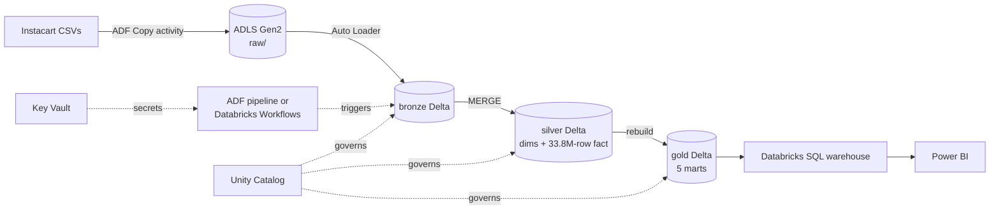

# Azure reference architecture for the Instacart platform

> **Status: design document only.** Nothing on this page has been deployed to Azure.
> It maps the components that *do* run in this repository onto their Azure equivalents,
> so the design can be discussed — and costed — in an Azure-stack interview. Do not
> describe any of it as built.

---

## Why this page exists

The repository runs on PostgreSQL + dbt (verified), Databricks + Delta Lake (the
lakehouse layer), and Airflow (orchestration). A large share of data engineering roles
in India run on Azure. The question an interviewer asks is: *"How would this look on
Azure?"* This is the answer, component by component, with the tradeoffs.

---

## Component mapping

| Concern | In this repo | Azure equivalent | Notes |
| :--- | :--- | :--- | :--- |
| Raw file landing | `data/raw/` CSVs; Unity Catalog volume on Databricks | **ADLS Gen2** container `raw/` (hierarchical namespace on) | Folder per source and load date: `raw/instacart/orders/load_date=YYYY-MM-DD/` |
| Ingestion | `src/database_loader.py`, `bronze.read_raw_csvs` | **Azure Data Factory** Copy activity (source → ADLS `raw/`) | ADF moves files; it does not transform them. Transform stays in Spark |
| Bronze / silver / gold storage | Delta tables in `instacart_bronze/_silver/_gold` | **Delta tables on ADLS Gen2**, containers `bronze/`, `silver/`, `gold/`, governed by **Unity Catalog** | One storage account, separate containers so access can differ by layer |
| Transformation | `spark/instacart_spark/` on Databricks serverless | **Azure Databricks** Job, same code unchanged | The package reads paths and catalog names from settings, so only config changes |
| Incremental loads | `MERGE INTO` per wave | Same `MERGE`, triggered per arriving file; **Auto Loader** (`cloudFiles`) to discover new files | Auto Loader replaces the simulated waves with real file arrival |
| Orchestration | Airflow DAGs (Astro) | Option A: **ADF pipeline** (Copy → Databricks Job activity) · Option B: **Databricks Workflows** alone · Option C: keep Airflow on **Astro on Azure** | See tradeoff below |
| SQL modelling (dbt) | dbt Core on PostgreSQL | dbt Core on **Databricks SQL warehouse** (`dbt-databricks`) | The cross-database macros already in the models are what make this a config change |
| Data quality | `quality.py` gates + 237 dbt tests | Same, plus Delta **CHECK constraints** / Lakeflow expectations | |
| Secrets | `.env`, Airflow connections | **Azure Key Vault**, Key Vault–backed Databricks secret scope | No tokens in code or Job JSON |
| Identity | personal access token | **Managed identity** / service principal with Databricks access connector for ADLS | No long-lived personal tokens in production |
| BI | Power BI spec on dbt marts | **Power BI** on the gold tables through a Databricks SQL warehouse | Import mode for the small marts; the 33.8M-row fact never leaves the lakehouse |
| Monitoring | `instacart_ops.pipeline_runs`, Airflow alerts | **Azure Monitor** / Log Analytics for ADF + Databricks diagnostic logs; alerts to Teams | The run-log table stays, as the queryable record of runtimes |

---

## Data flow

---

## Orchestration: which option, and why

| Option | Strength | Cost |
| :--- | :--- | :--- |
| **ADF → Databricks Job activity** | Native to Azure; visual; strong for file movement and many connectors | Weak for complex dependencies, branching and testing DAG logic in code |
| **Databricks Workflows only** | Fewest moving parts; the Job in `spark/databricks/` already is one | Orchestrates Databricks well, everything outside it less so |
| **Airflow (Astro on Azure)** | Same DAGs as this repo; code-reviewed, unit-tested orchestration across dbt + Databricks | Another platform to run and pay for |

**Recommendation for this workload:** ADF for landing files into ADLS, a Databricks Job
for bronze → gold, and dbt on a Databricks SQL warehouse — orchestrated by Databricks
Workflows. The workload is a single-platform transformation chain, so a third
orchestrator adds operational cost without adding capability. Airflow earns its place
when the pipeline spans many systems, which this one does not yet.

---

## Security and environments

- Three environments (dev / test / prod) as separate Databricks workspaces or catalogs,
  promoted by CI; storage accounts per environment.
- ADLS access through a Databricks **access connector** (managed identity) and Unity
  Catalog external locations — no storage keys in notebooks.
- Every secret in Key Vault; Databricks reads it through a Key Vault–backed scope.
- Network: VNet-injected Databricks workspace and private endpoints for ADLS and Key
  Vault, if the organisation requires no public traffic.

---

## What would change in the code

| File | Change |
| :--- | :--- |
| `spark/instacart_spark/config.py` | `RAW_DATA_PATH=abfss://raw@<account>.dfs.core.windows.net/instacart`, catalog name |
| `spark/instacart_spark/bronze.py` | Swap `spark.read.csv` for Auto Loader (`spark.readStream.format("cloudFiles")`) with `trigger(availableNow=True)` |
| `dbt/profiles.yml` | Add a `databricks` target (`dbt-databricks`) |
| `spark/databricks/instacart_lakehouse_job.json` | Unchanged apart from paths |

---

## Not done, deliberately

- No Azure resources were created: this is a portfolio project on free tiers.
- No cost figures are given. Pricing depends on region, tier and commitment; any number
  here would be a guess.
