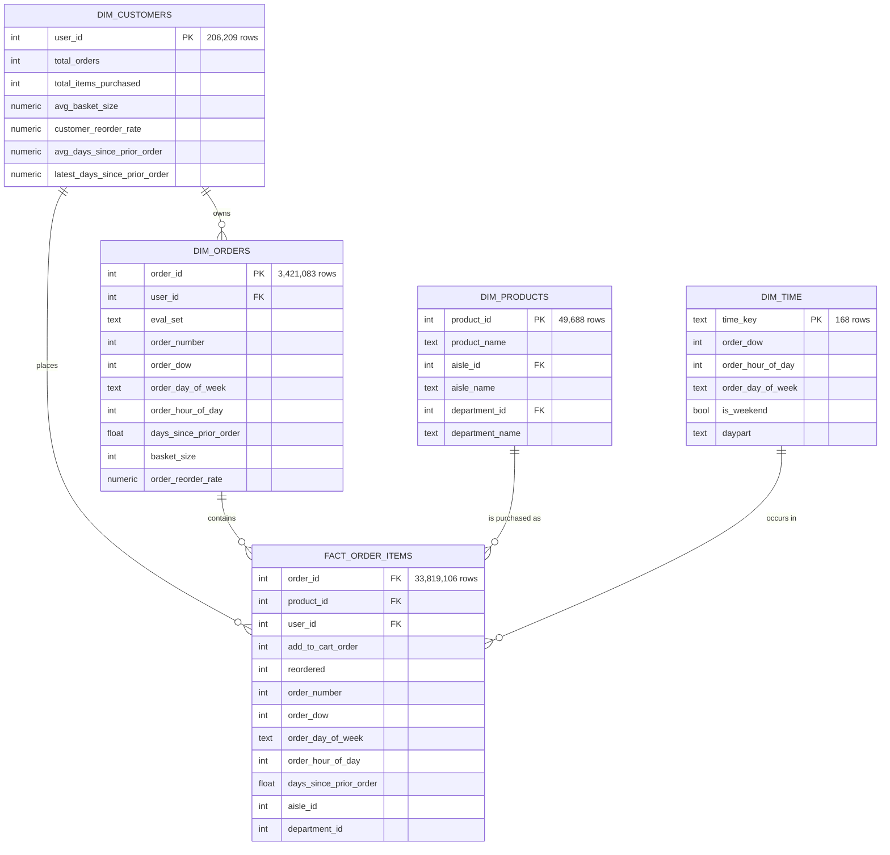
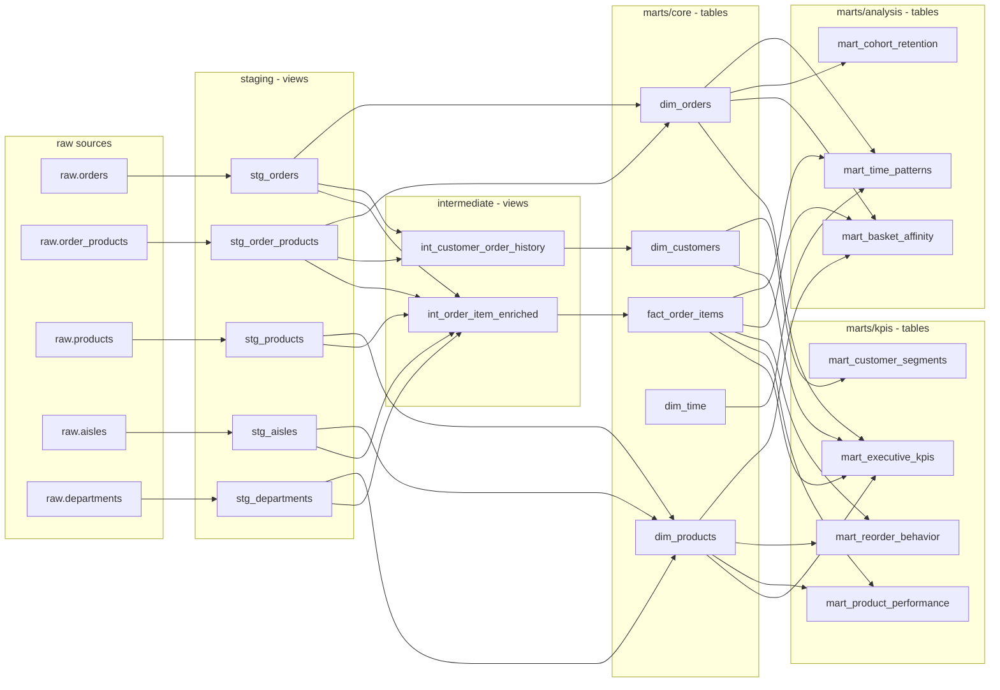

# Entity Relationship Diagram

The warehouse is a star schema: one line-item fact surrounded by four conformed
dimensions, with marts built on top. This diagram matches the actual `ref()` graph in
`dbt/models/` — regenerate the lineage view with `dbt docs generate` to confirm.

Row counts are from the verified PostgreSQL build.

## Star schema

### Grain and keys

| Table | Grain | Primary key | Rows |
| :--- | :--- | :--- | ---: |
| `fact_order_items` | one product within one order | `(order_id, product_id)` — enforced by a singular test, not a database constraint | 33,819,106 |
| `dim_orders` | one order | `order_id` | 3,421,083 |
| `dim_customers` | one customer | `user_id` | 206,209 |
| `dim_products` | one product | `product_id` | 49,688 |
| `dim_time` | one day-of-week × hour-of-day slot | `time_key` | 168 |

`dim_time` has no foreign key column on the fact table. The fact carries `order_dow` and
`order_hour_of_day` directly, and `mart_time_patterns` joins on that pair. Adding a
`time_key` column to a 33.8M-row fact to save a two-column join would cost more storage
than it saves in query time, and the pair is already indexed by the aggregation.

## Model lineage

### Materialization strategy

| Layer | Materialization | Why |
| :--- | :--- | :--- |
| staging | view | Thin type-casting and renaming only; materializing would duplicate the raw data for no gain |
| intermediate | view | Reused by exactly one or two downstream models; the query planner inlines them |
| marts/core, marts/kpis, marts/analysis | table | Read repeatedly by the BI layer and by other marts; the ~32M-row fact must not be recomputed per query |

Configured in `dbt/dbt_project.yml`.
